# スクショ付きセットアップ手順

## 事前に用意するもの

- 対応するMagisk導入済みTCL G06。TV側で地デジのチャンネル設定を済ませます。
- TVTestなどBonDriver対応ソフトを配置したWindows PC。
- TVとPCを接続する有線LANまたはWi-Fi。
- 初回設定用のADB。[Google公式Platform-Tools](https://developer.android.com/tools/releases/platform-tools)を入手し、`platform-tools` フォルダーをセットアップEXEの隣へ置くか、既存のADBをPATHに登録します。

## 1. ZIPを展開してWindowsツールを開く

`TCLTV-Bondriver-v0.4.0.zip` をすべて展開し、`TCL-BonDriver-Setup.exe` を起動します。

- **ADB接続先**：ネットワークADBなら `TVのIP:5555`。USB接続で接続機器が1台だけなら空欄で選択できます。
- **TVの接続先IP**：通常は空欄のままで構いません。「TVのIPを自動取得」は初期状態でオンです。接続方式は「自動（有線LAN優先）／有線LAN／Wi-Fi」から選択します。USBのADB接続からもTVのIPを取得できます。
- **TVTestのフォルダー**：`TVTest.exe` があるフォルダー。
- **2チューナー分のBonDriverを配置する**：2局を同時受信する場合はオンにします。

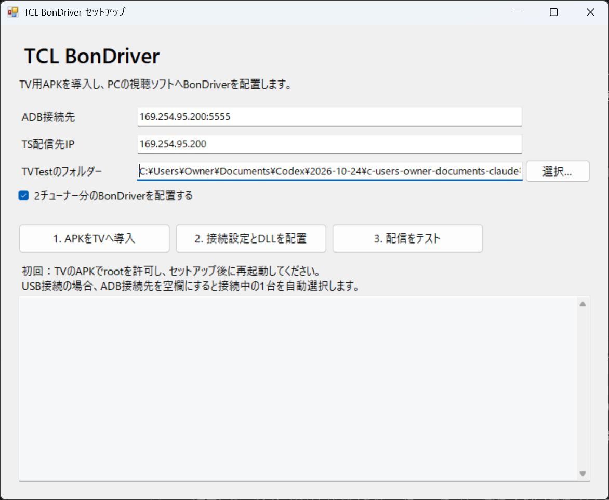

「1. APKをTVへ導入」を押すとTV用APKがインストールされ、TV側で開きます。初回はTV側でADBの接続許可を求められる場合があります。

## 2. TV側でセットアップとMagiskの許可を行う

TVの「TCL BonDriver セットアップ」で **「1. セットアップ」** を選びます。

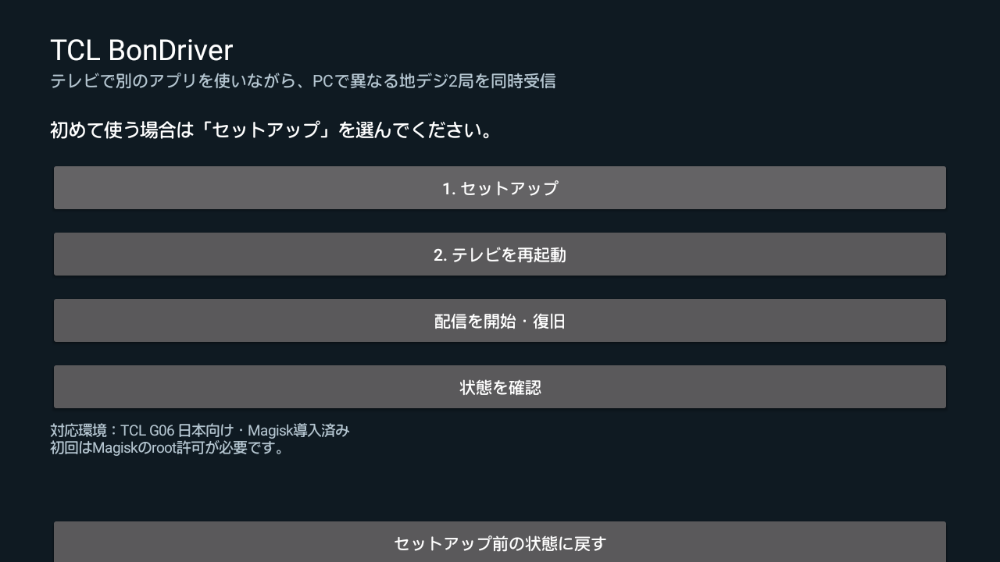

Magiskの要求が出たら、対象が **TCL BonDriver セットアップ / `io.github.long0823.tclbondriver`** であることを確認し、許可します。継続して使う場合は期間を「今後も」にします。

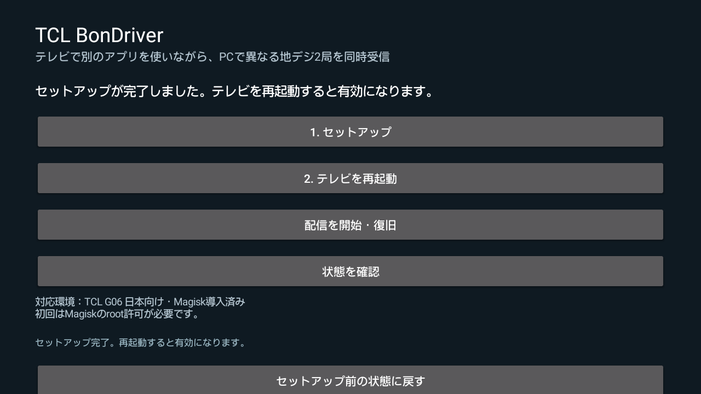

要求を時間切れ・拒否にした場合は、Magiskの「スーパーユーザー」画面でこのアプリのトグルをオンにし、APKのセットアップをもう一度実行してください。TVリモコンで操作できないトグルは、USBマウスなどのポインター入力で操作できます。

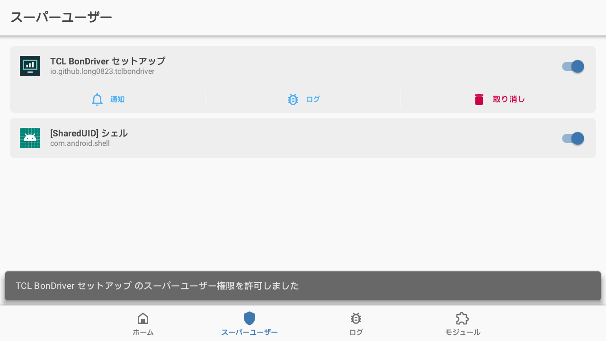

完了後、APKの **「2. テレビを再起動」** を選びます。起動後、配信機能が準備できるまで1～2分程度待ちます。APKの「状態を確認」で確認できます。

## 3. PCへDLLと接続設定を配置する

Windowsツールで **「2. 接続設定・局一覧を更新」** を押します。ここでも、初回はADBシェルへのroot許可が必要です。

TVTest.exeから32bit/64bitを判別し、次の2本を配置します。

| TVTestで選ぶDLL | チューナー | TSポート |
| --- | --- | --- |
| `BonDriver_TCLG06.dll` | 1系統目 | 40556 |
| `BonDriver_TCLG06_1.dll` | 2系統目 | 40558 |

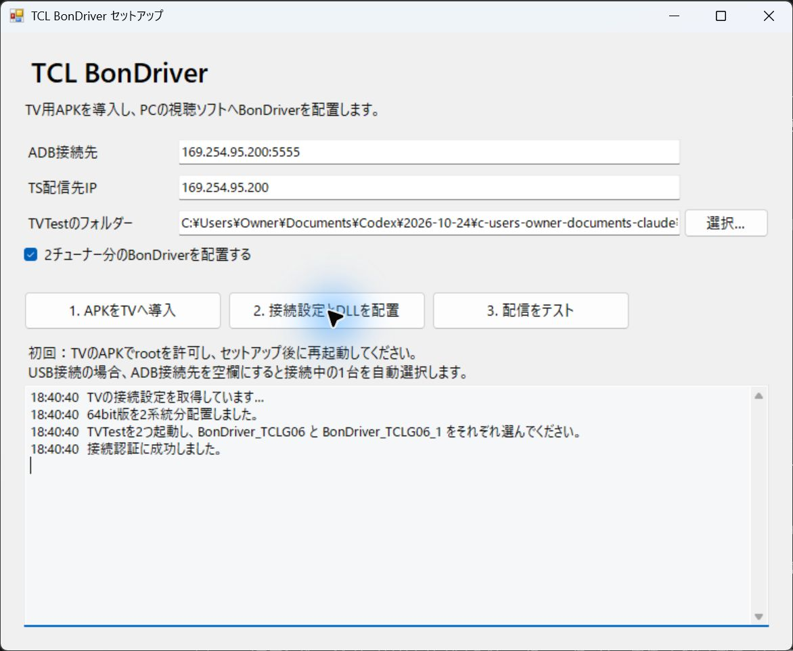

既存の同名DLL・INIは `.before-setup-日時` という名前へバックアップします。INIには機器固有キーが入るため、GitHubへのアップロードや第三者との共有はしないでください。

## 4. 配信をテストする

**「3. 配信をテスト」** を押します。各系統を5秒ずつ受信し、TS同期を確認します。初めて使う2系統目が未選局の場合、このテストでは取得済みの局一覧の先頭への初期選局を試みます。

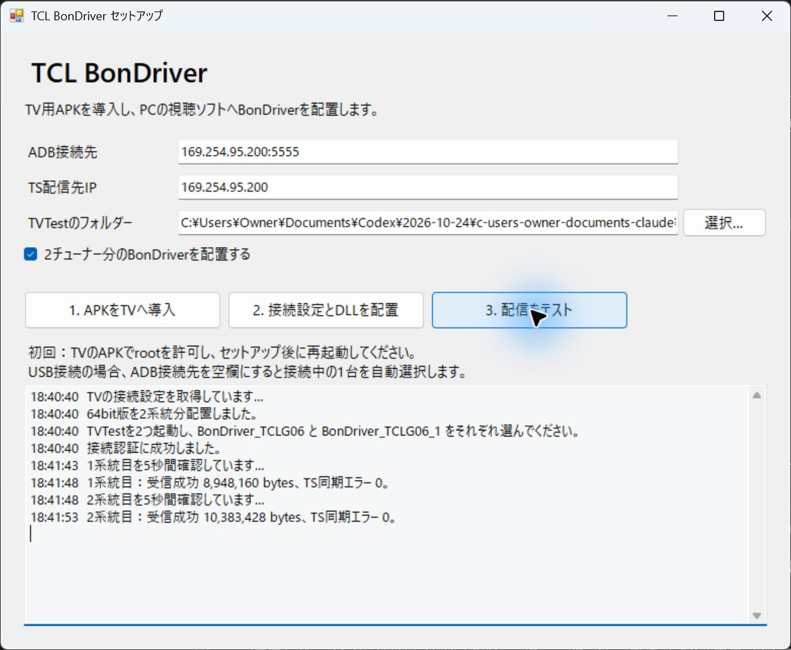

このボタンはTS同期の簡易テストです。映像・音声の最終確認はTVTestで行ってください。TVTestで受信中は同じ系統をテストツールから同時に開かないでください。

## 5. TVTestを設定する

1本目のTVTestでは `BonDriver_TCLG06.dll` を選びます。MPEG-2デコーダーと映像レンダラーも設定します。検証では **TVTest DTV Video Decoder / EVR** を使用しました。H.265デコーダーの案内は今回の地デジMPEG-2受信とは別です。

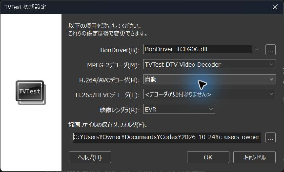

チャンネルスキャンの対象を `Terrestrial ISDB-T` にしてスキャンします。v0.4.0では実測C/Nを表示するため、「信号レベルを無視する」は必須ではありません。下のスキャン画像は旧版の画面です。

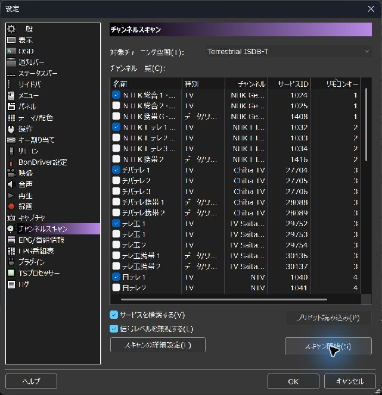

2本目のTVTestでは **`BonDriver_TCLG06_1.dll`** を選び、同様に設定・スキャンします。同じDLLを2本から選ぶと、チューナー重複使用として拒否されます。

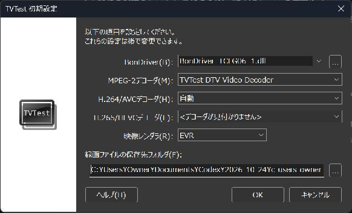

それぞれ別の局を選べば同時受信できます。TV側ではYouTubeなど別のアプリを前面で使用できます。

## ネットワークについて

通常のルーター経由なら、PCとTVを同じLANに接続し、TVの有線IPv4アドレスを入力します。

TVとPCをLANケーブルで直接接続する検証構成では、TV側に `169.254.95.200/16` を追加・維持します。PC側も同じリンクローカルネットワークにします。手動設定の例は `169.254.95.112`、サブネットマスク `255.255.0.0`、ゲートウェイ未設定です。既存のネットワーク設定を変更する前に現在の値を控えてください。

ADB用のWi-Fiアドレスと、TS配信用の有線アドレスは別でも構いません。日常の受信・選局ではUSB接続やPC側Pythonは不要です。

## 困ったとき

- **Permission denied**：Magiskで対象APKを許可し、再度セットアップします。
- **ADB接続できない**：TVのデバッグ接続許可と接続先を確認します。USBなら機器が1台か確認します。
- **キーを取得できない**：TVのセットアップ完了後に再起動し、ADBシェルにもrootを許可します。
- **映像が出ない**：対応局を選び、MPEG-2デコーダーを確認します。TV側の地デジ受信状態も確認してください。
- **0dBと表示される**：TV側APKとPC側DLLがともにv0.4.0以降か確認します。切断・未ロック・信号取得失敗時も0dBです。
- **TVTestのSカウンターが増える**：v0.4.0は追加音声・データPIDも復号対象にします。過去の累積値は自動で消しません。値が継続して増える場合は、旧版の常駐コードが残っていないか確認してTVを再起動し、PID一覧で未復号のPIDを確認してください。暗号化フラグだけを消す処理は行いません。
- **011は映るが012/013などが映らない**：APKとDLLを更新後、再選局・チャンネルスキャンを行います。v0.4.0はPATに含まれる各サービスのPMT/PIDを取得します。放送休止中の枝番号には独立した映像がない場合があります。
- **再起動後につながらない**：TV起動後しばらく待ち、APKの状態確認・配信の復旧を試します。IPが変わった場合はPC側で接続設定を作り直します。

## 元に戻す

TVのAPKで **「セットアップ前の状態に戻す」** を実行し、TVを再起動します。最初のセットアップ前に保存した起動設定を復元します。開発用の設定が先にあった場合は、その時点の設定へ戻ります。PC側は保存した `.before-setup-日時` のバックアップを使って戻せます。

## 有線LAN・Wi-FiのIP自動設定（v0.2.1）

TV用APKは有線LANとWi-FiのIPv4を画面上部に表示し、5秒ごとに更新します。未接続の方式は「未接続・IPv4未取得」と表示します。

Windowsツールで「TVのIPを自動取得」をオンにすると、「接続設定とDLLを配置」を押す際にTVのIPをADB経由で取得し、2系統のBonDriverのHostへ設定します。「IP取得」ボタンでも確認できます。自動モードは有線LANを優先し、両方にIPがある場合はPCから配信サービスに接続できる方を選びます。「有線LAN」「Wi-Fi」で明示的に選択することもできます。

初回のADB接続は必要です。USBならADB接続先を空欄にでき、ネットワークADBなら初回だけTV画面に表示されたIP:5555を入力します。ネットワーク全体のTV探索や、TV・PCへの固定IP割り当ては行いません。

IPが変わった場合は、視聴ソフトを閉じて「接続設定とDLLを配置」をもう一度実行してください。起動中のBonDriverのHostは自動変更しません。手動入力する場合は自動取得をオフにします。

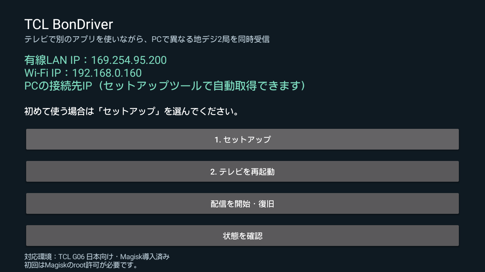
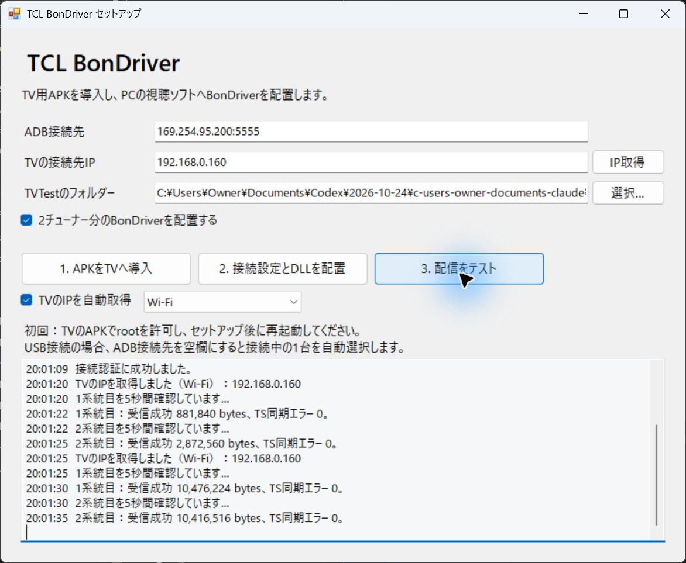

## TVのスキャン結果を局一覧へ反映する（v0.3.0）

TV本体の地デジスキャンを完了し、TVTestを閉じてWindowsツールの「2. 接続設定・局一覧を更新」を実行します。TVのチャンネルDBから表示対象の地デジAVサービスを取得し、両系統のINIへ日本語名・表示番号・ONID・TSID・ServiceIDを保存します。BS/CS、データ専用、TV側で非表示のサービスは除外し、同じ選局IDは重複登録しません。取得失敗・0件の場合は既存設定を変更しません。

DLLを読み直し、TVTestでもチャンネルスキャンをやり直してください。旧版からは局の並びとインデックスが変わるため、以前のTVTest局設定をそのまま使わないでください。TV側で再スキャンした場合も同じ手順で更新します。日常のBonDriver受信時にはADBは不要です。

新APKでは起動時の初期局もTVの登録局から選びます。対応ハードウェア・ファームウェアの条件は従来と同じで、他地域の実機での受信試験は未実施です。

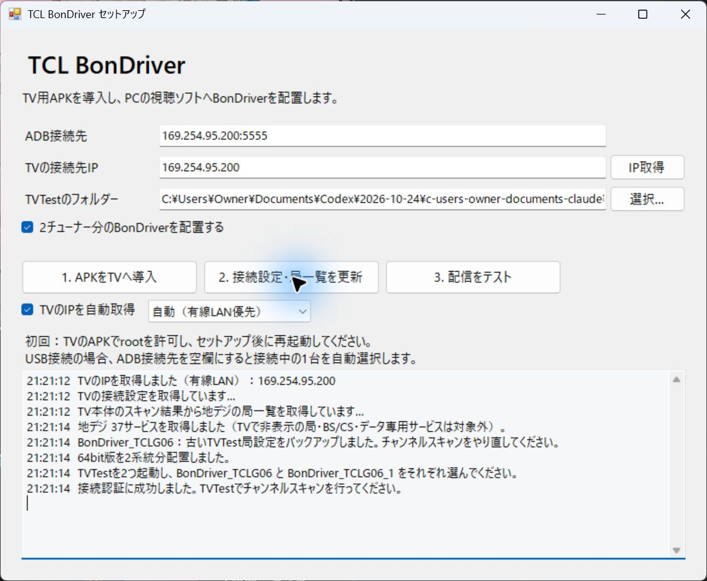

局一覧が変わった場合、対象BonDriverの既存 .ch2 は .before-setup-日時 にバックアップして退避します。局一覧に変更がない更新では既存の .ch2 を保持します。

## v0.4.0の受信確認

信号欄は実測C/N（dB）です。サービスメニューから012・022・023などへ切り替え、映像・音声とSカウンターを確認します。ストリームの情報 → PIDでは、各サービスのPMTとデータPIDが受信できることを確認できます。次の画像は012選択中の実機画面です。

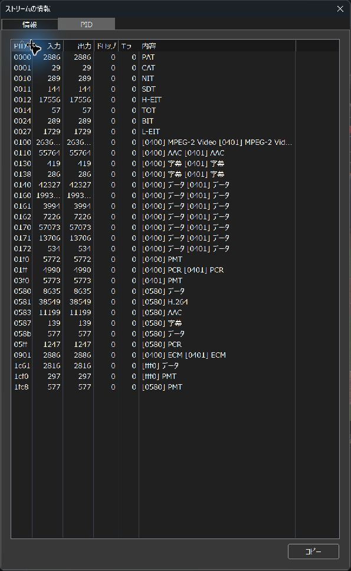

検証条件と測定結果は [v0.4.0検証記録](../validation/signal-multiprogram-v0.4.0.md) を参照してください。
