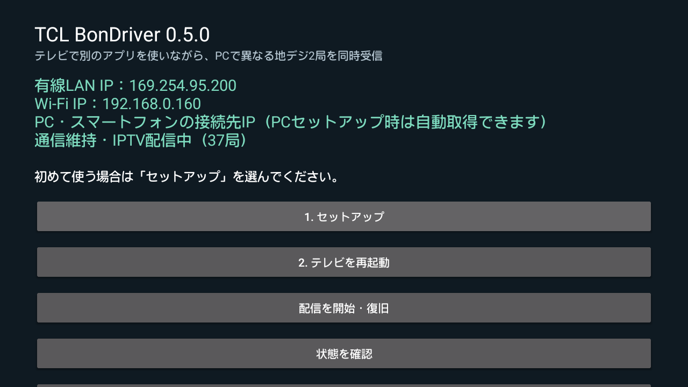

# 0.5.0への更新と画面消灯中の通信維持

## 更新

1. [0.5.0のReleases](https://github.com/Long0823-1/TCLTV-Bondriver/releases/tag/v0.5.0)から一式ZIPを展開します。TV用APKだけのダウンロードも用意しています。
2. Windowsセットアップの「APKをTVへ導入」でTV用APKを上書きします。
3. TVで「1. セットアップ」を実行し、Magiskのroot許可を確認します。0.5.0はネイティブ配信も更新するため、APKの上書きだけで終わらず、セットアップを実行してください。
4. TVを一度再起動します。通常起動後は配信と通信維持が自動で戻ります。
5. TVで「画面消灯中の通信維持を有効にする」を選ぶと、許可設定を再適用できます。ネットワーク状態欄に通信維持・IPTVの状態が表示されます。

TVで別のアプリを開いても常駐サービスは動きます。日常の選局・受信にPC側Python、USB、ADBの常駐は不要です。従来のBonDriver設定・接続キーを引き続き利用できます。

## 対策内容

フォアグラウンドサービスがCPUの部分ウェイクロックとWi-Fi維持ロックを持ちます。TCLの常駐・自動起動・サービス再開などの許可リストにはこの配信アプリだけを追加します。AC給電時の深い待機を避ける電源設定も保存・変更します。AndroidのADB設定が有効な対応TVを対象にしています。

通常のリモコン短押しで画面は消灯できます。Wi-Fi・有線LANと配信処理を動かすため、通常の省電力待機より消費電力が増え、AC給電中の自動消灯も抑制されます。

第1チューナーはメーカー側で消灯時に一時停止されることがあるため、正規のnull TSで接続を保持しながら早めに再捕捉します。null TSには映像・音声を含めません。実際の受信が戻るまで映像・音声が短く止まる場合があります。第2チューナーも同時利用できます。同じチューナーを別のソフトから同時に選局しないでください。

## 止める・戻す

TVの「通信維持を停止する」でサービスとIPTVを停止し、今回追加したTCL許可と保存済みの電源設定を戻します。「セットアップ前の状態に戻す」も通信維持を停止してから既存のネイティブ設定を復元します。

再起動中や完全な電源切断中の配信はできません。検証した範囲は[実機検証](../validation/v0.5.0.md)に記載しています。