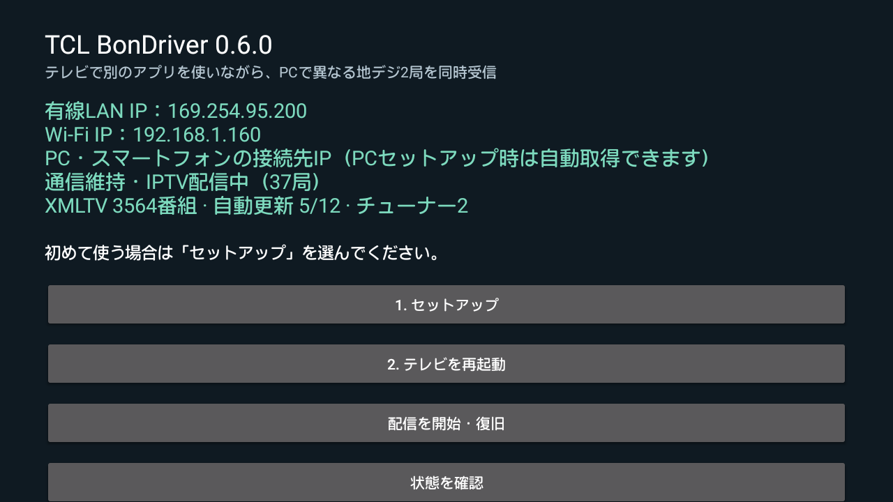

# XMLTV番組表（TV 0.6.0 / スマホ 0.4.1）

TVが放送TSのEITを収集し、XMLTV形式の番組表を配信します。M3Uの `tvg-id` とXMLTVの `channel id` は共通の `ONID-TSID-SID`。日本語の番組名・説明・開始終了時刻を含み、UTF-8・UTC（+0000）で出力します。

## 導入と登録

1. TV APKを0.6.0へ上書きし、TVの「1. セットアップ」を実行して一度TVを再起動します。今回もネイティブ配信本体を更新します。APK上書きだけでは視聴優先制御は有効になりません。
2. 通信維持を有効にしておくと、起動後に空きチューナーで番組表を自動収集します。全多重を一巡した後は3時間ごとに更新します。
3. M3UをIPTVプレーヤーへ再登録・再読み込みします。M3Uの `url-tvg` / `x-tvg-url` から対応プレーヤーが番組表を認識できます。未対応の場合はXMLTV/EPG欄へXMLのURLを登録してください。
4. TVの「IPTVのM3U・番組表XMLを表示」でURLを確認できます。スマホ版0.4.1ではTVの確認コードで接続情報を再取得し、「IPTVのM3U接続先」→「番組表XMLをコピー」でコピーします。

```text
M3U: http://TVのIP:40560/iptv/IPTV専用キー/playlist.m3u?tuner=1
XML: http://TVのIP:40560/iptv/IPTV専用キー/epg.xml
gzip: http://TVのIP:40560/iptv/IPTV専用キー/epg.xml.gz
```

XMLは両チューナー共通です。実際のURL・M3Uには接続キーが含まれるため公開しないでください。

## 自動取得と視聴優先

- 番組表収集は第2チューナーを優先して空きを探し、使用中なら第1チューナーも確認します。両方使用中なら待機します。
- BonDriver・専用スマホ・IPTVから通常の選局要求やTS接続が来た場合、配信本体が番組表用の占有を取り消し、収集を中断します。視聴要求を番組表のために拒否する方式ではありません。
- 視聴中のチューナーは自動選局しません。切断後も30秒間は再接続を優先して待機し、その後に空きチューナーで未収集分から再開します。
- XMLやM3Uの取得だけでは視聴とは扱わず、選局もしません。保存済み番組表を取得するだけです。
- 受信中のEITはTV内部のループバック経路で収集します。BonDriver・専用スマホでの視聴中も、視聴を止めずに現在の放送波の番組情報を蓄積できます。
- TVの「番組表XMLを今すぐ更新（視聴優先）」で更新を早められます。この操作でも視聴が優先されます。チューナーを手動で空ける必要はありません。
- 起動時のチューナー復元を優先し、起動直後は収集を待機します。背景収集で選んだ局を、視聴用の起動復元局として保存しません。

## 保存と制限

取得した情報をアプリ専用領域へ保存し、サービス再起動・APK上書き後も再利用します。最大10,000番組、過去6時間から9日先までを保持します。受信できた情報だけの番組表で、初回収集前・未受信局・臨時サービスは番組が空の場合があります。全局の1週間分を保証しません。一部のARIB外字・DRCSは□や代替表記です。

通常の視聴と同じく、画面消灯中の収集には通信維持が必要です。完全な電源断や再起動中には配信できません。番組表更新はTV内で完結し、PC中継・Python・ADBの常駐は不要です。

XMLTVの構造は[公式DTD](https://github.com/XMLTV/xmltv/blob/master/xmltv.dtd)に合わせています。検証範囲は[0.6.0の記録](../validation/v0.6.0.md)を参照してください。



状態欄で保存番組数・自動更新の進捗を確認できます。IPアドレスは検証機のもので、自分のTVの表示を使用してください。
