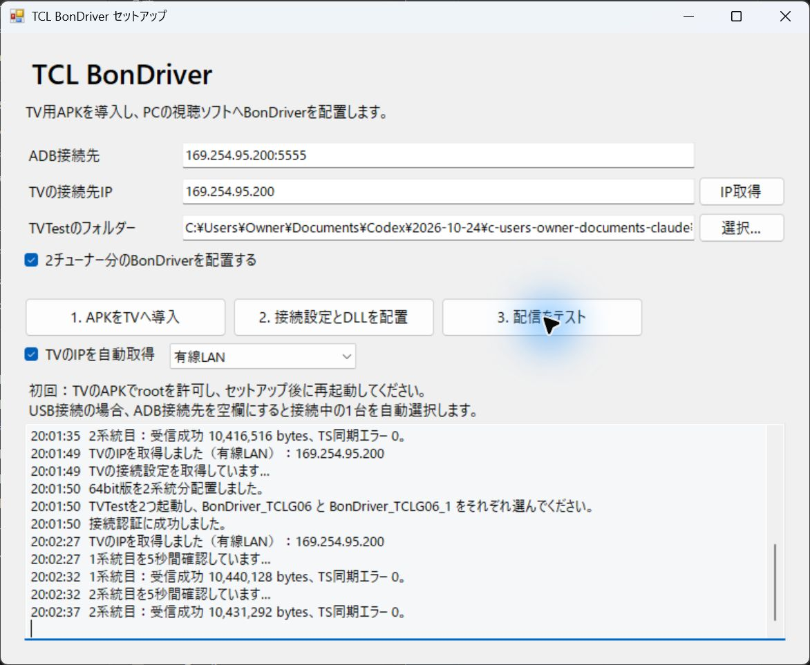

# v0.2.1 ネットワーク検証

2026-10-24 JST、実機TCL G06。WindowsセットアップツールとTV APKを使用。

- TV APK：有線LAN 169.254.95.200 と Wi-Fi 192.168.0.160 の両方を表示。画面とUIダンプで確認。
- PCツール：自動モードは有線LANを選択。Wi-Fi指定は192.168.0.160、有線LAN指定は169.254.95.200を取得。
- 両方式で認証成功、x64 BonDriverを2系統分配置。最後の有線LAN設定では両INIのHostが169.254.95.200であることを確認。
- Wi-Fi：チューナー0 10,476,224 bytes、チューナー1 10,416,516 bytes、TS同期エラーはいずれも0。
- 有線LAN：チューナー0 10,440,128 bytes、チューナー1 10,431,292 bytes、TS同期エラーはいずれも0。
- 各方式の各系統を順番に約5秒ずつ確認する短時間試験。Wi-Fiの長時間安定性・すべての無線環境での性能は未検証。
- 初回ADB接続は別途必要。固定IPの割り当て・LAN全体のTV探索・起動中BonDriverのIP変更は行わない。

